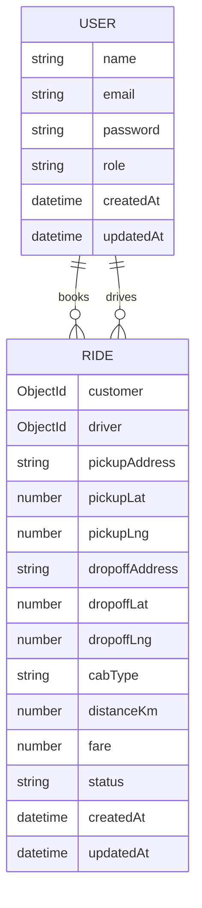
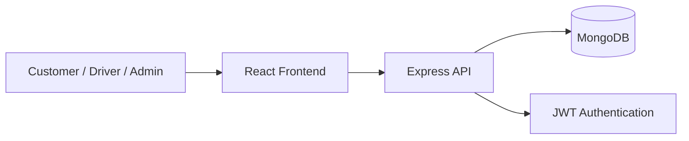
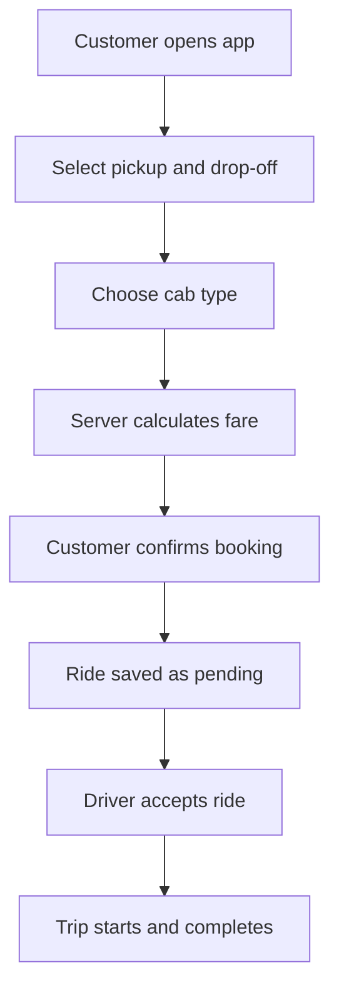

# RideMint

RideMint is a full-stack Uber-style ride booking demo built with the MERN stack for a college major/minor project. This project includes customer booking workflows, a driver dashboard, admin analytics, JWT-based authentication, and a reusable map-based ride booking flow.

## Features

- Customer registration and login
- JWT authentication and role-based authorization
- Ride booking with pickup and drop-off locations
- Estimated fare calculation using the Haversine formula
- Driver ride acceptance and status workflow
- Admin dashboard with summary stats and user management
- Responsive frontend built with React + Vite
- REST API backend using Express and MongoDB
- Error handling, validation, and structured responses

## Tech stack

### Frontend

- React
- Vite
- JavaScript
- React Router DOM
- Axios
- React Leaflet
- Leaflet
- OpenStreetMap

### Backend

- Node.js
- Express
- MongoDB + Mongoose
- JWT
- bcryptjs
- dotenv
- CORS

## Project structure

```text
uber-clone/
├── client/
│   ├── public/
│   ├── src/
│   │   ├── components/
│   │   ├── context/
│   │   ├── pages/
│   │   ├── services/
│   │   ├── utils/
│   │   ├── App.jsx
│   │   ├── main.jsx
│   │   └── styles.css
│   ├── .env.example
│   ├── index.html
│   ├── package.json
│   └── vite.config.js
├── server/
│   ├── src/
│   │   ├── config/
│   │   ├── controllers/
│   │   ├── middleware/
│   │   ├── models/
│   │   ├── routes/
│   │   ├── utils/
│   │   ├── app.js
│   │   └── server.js
│   ├── .env.example
│   └── package.json
├── .gitignore
├── package.json
├── README.md
└── .env.example (optional root config)
```

## Prerequisites

- Node.js 18+
- npm
- MongoDB running locally or MongoDB Atlas account
- Git
- VS Code

## Environment setup

### Server

Create a file named `.env` inside the `server` folder using the example values:

```env
PORT=5000
MONGO_URI=mongodb://127.0.0.1:27017/ridego
JWT_SECRET=replace_with_a_long_random_secret
CLIENT_URL=http://localhost:5173
NODE_ENV=development
```

### Client

Create a file named `.env` inside the `client` folder:

```env
VITE_API_URL=http://localhost:5000/api
```

## MongoDB setup

### Local MongoDB

1. Install MongoDB Community Edition.
2. Start the MongoDB service locally.
3. Keep the default URI: `mongodb://127.0.0.1:27017/ridego`.

### MongoDB Atlas

1. Create a free Atlas cluster.
2. Create a database user.
3. Whitelist your IP.
4. Copy the connection string and replace `MONGO_URI` in the server environment file.

## Installation

From the root folder:

```bash
npm install
cd server && npm install
cd ../client && npm install
```

## Start the app

### Backend

```bash
cd server
npm run dev
```

### Frontend

Open a new terminal:

```bash
cd client
npm run dev
```

Then open the frontend URL shown by Vite, typically `http://localhost:5173`.

## API overview

### Authentication

- `POST /api/auth/register`
- `POST /api/auth/login`
- `GET /api/auth/me`
- `POST /api/auth/logout`

### Customer rides

- `POST /api/rides`
- `GET /api/rides/my-rides`
- `GET /api/rides/`
- `PATCH /api/rides/:id/cancel`

### Driver APIs

- `GET /api/driver/rides/available`
- `GET /api/driver/rides/assigned`
- `PATCH /api/driver/rides/:id/accept`
- `PATCH /api/driver/rides/:id/status`

### Admin APIs

- `GET /api/admin/stats`
- `GET /api/admin/rides`
- `GET /api/admin/users`
- `GET /api/admin/rides/:id`

### Health check

- `GET /api/health`

## Fare calculation

The demo fare rules use a straight-line estimate between the pickup and drop-off coordinates:

- Mini: ₹40 base + ₹12 per km
- Sedan: ₹60 base + ₹16 per km
- SUV: ₹90 base + ₹21 per km

Formula:

```text
fare = baseFare + distanceKm * ratePerKm
```

The distance is calculated with the Haversine formula and rounded to two decimal places.

## Database schema

### User

- `name`
- `email`
- `password`
- `role` (`customer`, `driver`, `admin`)
- timestamps

### Ride

- `customer`
- `driver`
- `pickup` (`address`, `latitude`, `longitude`)
- `dropoff` (`address`, `latitude`, `longitude`)
- `cabType`
- `distanceKm`
- `fare`
- `status` (`pending`, `accepted`, `in_progress`, `completed`, `cancelled`)
- timestamps

## Role setup

For the demo project, create admin or driver accounts through a secure setup process rather than a public role selection form.

Example flow:

```bash
# Create a customer account through the public register form.
# Then update the role in MongoDB directly for demo use.
```

```js
db.users.updateOne(
  { email: 'admin@example.com' },
  { $set: { role: 'admin' } }
);
```

For a driver account:

```js
db.users.updateOne(
  { email: 'driver@example.com' },
  { $set: { role: 'driver' } }
);
```

## Testing

Run backend tests with:

```bash
cd server
npm test
```

## Screenshots

Add screenshots here when running the app locally.

## Known limitations

- This is a demo app, not a production taxi platform.
- Distance is estimated straight-line distance, not live road routing.
- Real-time GPS tracking is not implemented in the base version.
- Local MongoDB must be running before the backend starts.

## Future enhancements

- Socket.IO updates for live ride status changes
- Google Maps or Mapbox integration
- Payment flows
- Driver and admin dashboards with richer analytics
- Real reverse geocoding
- Better validation and rate limiting

## ER diagram



## System architecture



## Ride booking flow



## Sample API requests

### Register user

```bash
curl -X POST http://localhost:5000/api/auth/register \
  -H "Content-Type: application/json" \
  -d '{
    "name": "Alice",
    "email": "alice@example.com",
    "password": "password123"
  }'
```

### Sample response

```json
{
  "success": true,
  "token": "jwt-token",
  "user": {
    "_id": "abc123",
    "name": "Alice",
    "email": "alice@example.com",
    "role": "customer"
  }
}
```

## Notes

This project is created as an educational demo and should not be used as a production commercial taxi service without additional security, compliance, and operational safeguards.
